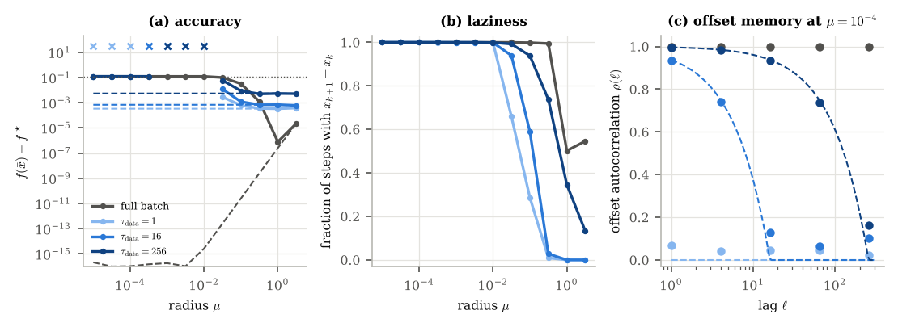
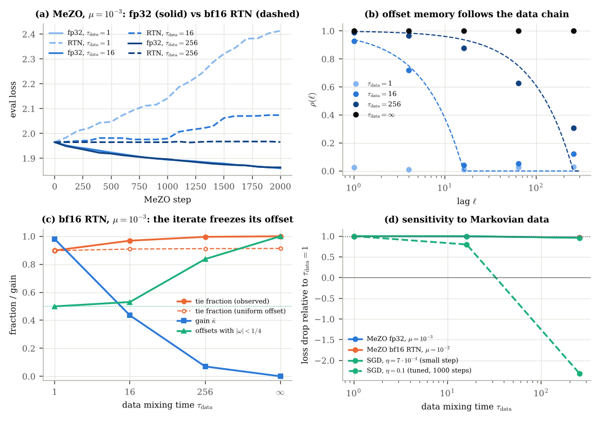

# Rounding as a lazy Markov chain

**Purpose.** The rounding error of a value f(x) is set by its position on the grid, the *offset* ω = f(x)/u − round(f(x)/u). The offset is moved by the data (a new minibatch) and by the method (only on non-tie steps); a tie freezes the iterate, so with unchanged data the offset repeats. This experiment checks that picture: does the offset's memory follow the data chain, and what happens to rounded zeroth-order methods when the data are correlated?

Correlated data are modelled by a *lazy* data chain: each minibatch is reused for τ_data consecutive steps (τ_data = 1 is fresh data every step).





## What is run

| Part | Setup |
| --- | --- |
| Convex (`convex/`) | logistic regression of `../rounded_oracle_convex` (d = 50, n = 500), values rounded to 8 bits (bf16 precision), B = 5 directions per step, 10⁴ steps, 12 radii μ ∈ [10⁻⁵, 10^0.5], 2 instances; data modes: full batch, and minibatches of 50 rows reused for τ_data ∈ {1, 16, 256}; every mode repeated with exact values (`chain3.py`); random unit start x₀ (at x₀ = 0 the logistic loss is data-independent) |
| MeZO (`run.py`) | model, data and checkpoint of `../rounded_oracle_mezo`; 2000 steps, η = 5·10⁻⁴; τ_data ∈ {1, 16, 256} and a frozen batch (τ_data = 2000); oracles fp32 and bf16 RTN; μ ∈ {10⁻³, 10⁻²}; first-order SGD on the same batches with η = 7·10⁻⁴ (2000 steps) and η = 0.1 (1000 steps); one seed |

## How to reproduce

```bash
# needs ../rounded_oracle_mezo/pretrained.pt (python ../rounded_oracle_mezo/pretrain.py)
python convex/chain2.py          # rounded values  -> convex/chain2.json
python convex/chain3.py          # exact values    -> convex/chain3_exact.json
bash lane1.sh & bash lane2.sh    # MeZO and SGD runs -> runs/*.json
bash lane3.sh & bash lane4.sh    # SGD with the small step
python analyze.py                # -> summary.json (per-run diagnostics)
python drift.py rtn_tau1_mu0.001_lr0.0005_s0 rtn_tau16_mu0.001_lr0.0005_s0 rtn_tau256_mu0.001_lr0.0005_s0 \
  rtn_tau2000_mu0.001_lr0.0005_s0 rtn_tau1_mu0.01_lr0.0005_s0 rtn_tau256_mu0.01_lr0.0005_s0 \
  fp32_tau1_mu0.001_lr0.0005_s0 fp32_tau16_mu0.001_lr0.0005_s0 fp32_tau256_mu0.001_lr0.0005_s0   # -> drift.json
python make_figures.py           # -> figures/*.png, figures/*.pdf, figures/numbers.json
```

## How to read the data

`runs/<mode>_tau<τ>_mu<μ>_lr<η>_s<seed>.json` (`sgdsweep_lr*.json`: 300-step SGD step-size sweep):

| Field | Meaning |
| --- | --- |
| `args` | run arguments (`mode` ∈ fp32, rtn, sgd; `tau` = τ_data) |
| `eval` | `[step, eval_loss]` |
| `step.lp`, `step.lm` | true (fp32) values f(x+μz), f(x−μz) at every step |
| `step.op`, `step.om` | values returned by the oracle (rounded for `rtn`) |
| `step.ulp` | bf16 unit u at the stencil centre |
| `step.bid` | minibatch index (changes every τ_data steps) |

`summary.json` (from `analyze.py`), per run: `tie` and `tie_pred_uniform` (observed tie fraction and the prediction for a uniform offset), `kappa_hat` = Σ Δ_Q Δ_f / Σ Δ_f² (empirical gain of the rounded difference; 1 = unbiased), `rho` (offset autocorrelation |E e^{2πi(ω_{k+ℓ} − ω_k)}| at lags ℓ = 1, 4, 16, 64, 256), `sigmaF_over_u` (loss spread across batches in grid units), `drop` (eval-loss drop). `drift.json`: share of offsets in the cell interior (|ω| < 1/4) and mean |ω| at the start and end of a data block.

`convex/chain2.json`, `convex/chain3_exact.json`: keys `<mode><τ>_<seed>` (`full0` = full batch); per radius `floor` = f(x̄) − f*, `tie`, `hold` (share of steps where the iterate did not move), `rho` (offset autocorrelation over the first 2000 steps), `sF_over_u`.

## Main result

- **The offset's memory follows the data chain**: ρ(ℓ) tracks the envelope (1 − ℓ/τ_data)₊ (e.g. 0.94 at lag 1 for τ_data = 16; 1.00, 0.94, 0.74 at lags 1, 16, 64 for τ_data = 256 on the convex problem).
- **Sub-cell radii either blow up or freeze**, and the data chain decides which: with fresh data every run blows up, with lazy data the iterate often never moves, with the full batch it is absorbed at x₀.
- **With lazy data the method drives its own offset into the frozen region** (MeZO, bf16, μ = 10⁻³): interior share 0.50 → 0.84, gain κ̂ 0.98 → 0.07, ties 0.996 vs 0.912 predicted. The harm of rounding (loss change −0.448 at τ_data = 1) turns into paralysis (−0.001 at τ_data = 256). fp32 runs show no such effect.
- **At good radii rounding costs nothing beyond the data's own Markov cost**: convex, rounded = exact within 8% for μ ∈ [0.3, 3]; MeZO at μ = 10⁻² keeps 95% of the fp32 progress at τ_data = 1 and 256.
- **Open**: MeZO in fp32 loses only 4% at τ_data = 256, but so does SGD with a comparably small step; separating the two needs a comparison at equal target loss.

## Limitations

One seed per MeZO configuration; small model; lazy chains are the simplest Markov chains, not natural data streams.
