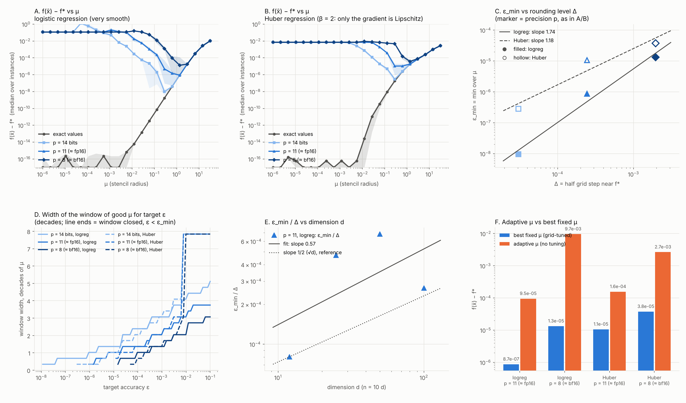

# Rounded oracle on convex problems

**Purpose.** Measure how accurate a two-point zeroth-order method can be when function values are rounded to p significant bits, on convex problems with a known optimum, and whether the window of good smoothing radii closes as the target accuracy decreases.



## What is run

| Item | Choice |
| --- | --- |
| Problem A | ℓ₂-regularised logistic regression, d = 50, n = 500, λ = 10⁻²; f* by Newton's method; 3 instances |
| Problem B | Huber regression (gradient Lipschitz, Hessian discontinuous), λ = 10⁻², +0.5 offset; 2 instances |
| Precision | values rounded (RTN) to p ∈ {14, 11, 8} significant bits, plus exact float64 |
| Method | two-point estimator with B = 5 random directions on the unit sphere per step, η = 0.5 / (L(d/B + 1)), 10⁴ steps, x₀ = 0 |
| Output | f(x̄) − f*, x̄ = mean of the last half of the iterates |
| Radii | 23 values μ ∈ [10⁻⁶, 10^1.5], all run in one vectorised batch |
| Extra | dimension sweep d ∈ {12, 25, 50, 100} at p = 11; a one-sided adaptive radius rule |

## How to reproduce

```bash
python exp.py main     # logistic regression -> main.json
python exp.py huber    # Huber regression    -> huber.json
python exp.py dim      # dimension sweep     -> dim.json
python analyze.py      # -> zo_convex_rounding.png and a printed summary
```

## How to read the data

`main.json`, `huber.json`: keys `<p>_<seed>` (`None` = exact values) and `adapt<p>_<seed>` (adaptive radius). `dim.json`: keys `<d>_<seed>`.

| Field | Meaning |
| --- | --- |
| `mus` | radii of the batch |
| `floor` | f(x̄) − f* per radius (averaged iterate) |
| `last` | f(x_T) − f* per radius (last iterate) |
| `curve` | `[step, [f(x_t) − f* per radius]]`, 60 snapshots |
| `fstar`, `L`, `lam`, `R` | optimal value, smoothness constant, regularisation, ‖x*‖ |
| `final_mu` | final radius of the adaptive rule |

## Main result

- The accuracy floor is **U-shaped in μ**: small radii stall (the iterate stays at x₀), large radii pay the smoothing bias.
- The **window of good radii closes** at a precision-dependent ε_min, sooner for the less smooth Huber problem.
- ε_min is **2–4 orders of magnitude below the rounding level** Δ = u/2 (e.g. 1.3·10⁻⁵ at p = 8, Δ = 1.95·10⁻³, logistic regression).
- A one-sided adaptive radius rule loses 15–724× against the best fixed radius.

## Limitations

d = 50 and 2–3 instances per problem; fitted exponents use three precisions on a grid of radii with 0.34-decade spacing and are coarse; the dimension dependence is inconclusive.
