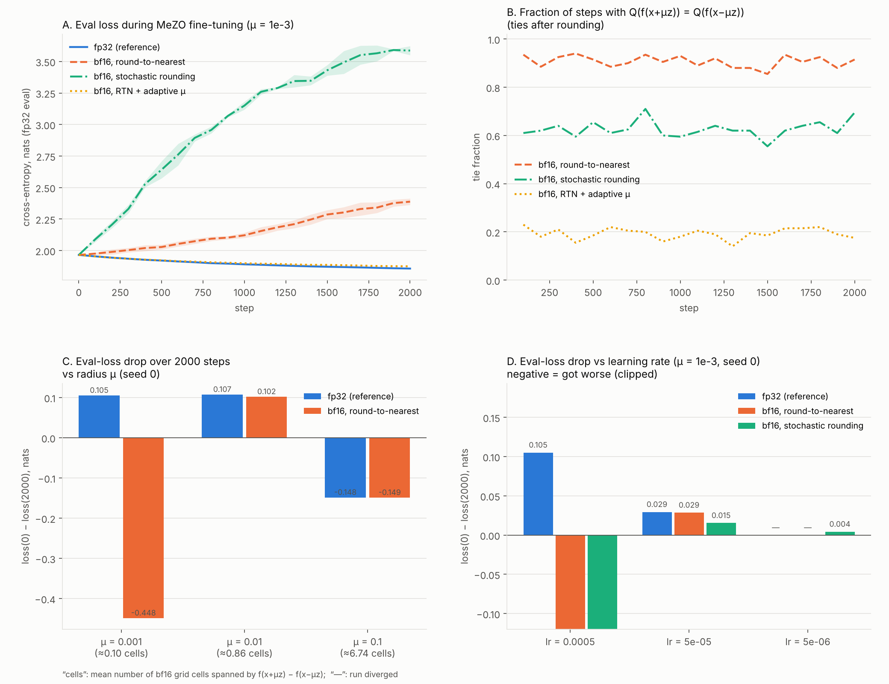

# Rounded oracle in MeZO fine-tuning

**Purpose.** Check what happens to MeZO (two-point zeroth-order fine-tuning) when the returned loss value is rounded to bf16, and whether the logged tie fractions follow the closed-form tie law.



## What is run

| Item | Choice |
| --- | --- |
| Model | character-level causal transformer, 4 layers, width 128, 4 heads, context 64, vocabulary 96; d = 826,208 parameters |
| Pre-training | AdamW, lr 2·10⁻³, batch 32×64, 1500 steps on Python standard-library source code (`pretrain.py`) |
| Fine-tuning data | licence and documentation text shipped with the OS (domain shift); 80/20 train/eval split |
| Method | MeZO: Gaussian direction z over all parameters, central difference, the same minibatch for both evaluations, batch 32×64, 2000 steps |
| Oracle modes | `fp32` exact value · `rtn` value cast to bf16 · `sr` stochastic rounding to bf16 · `rtn_adapt` RTN with an adaptive radius |
| Isolation | the forward pass is always fp32; only the returned scalar is rounded; all modes share batches and directions |
| Main setting | μ = 10⁻³ (MeZO default), η = 5·10⁻⁴; seeds 0 and 1 |
| Sweeps | μ ∈ {10⁻³, 10⁻², 10⁻¹}; η ∈ {5·10⁻⁴, 5·10⁻⁵, 5·10⁻⁶}; a 600-step fp32 sweep to choose η |

## How to reproduce

```bash
python pretrain.py      # writes pretrained.pt (~3 MB, not committed)
bash grid.sh            # main comparison + radius sweep (2 parallel lanes)
bash extra.sh           # step-size sweep
# η sweep used to pick the step (600 steps, fp32):
#   python mezo.py --mode fp32 --steps 600 --eval_every 150 --lr 1e-3 --tag sweep_lr1e-3   (also 3e-3, 3e-4, 1e-4, 3e-5)
python analyze.py       # -> zo_bf16_rounding.png
python ties_vs_logs.py  # tie law vs logged ties -> ties_vs_logs.json
```

## How to read the data

`runs/<mode>_mu<μ>_lr<η>_s<seed>.json` (tagged runs: `runs/<tag>.json`; `sweep_lr*.json` = the 600-step η sweep):

| Field | Meaning |
| --- | --- |
| `args` | command-line arguments of the run |
| `eval` | list of `[step, eval_loss]`; exact fp32 cross-entropy on 10 fixed held-out batches, every `eval_every` steps |
| `win` | one entry per evaluation window: `tie_frac` (share of steps with Q(f₊) = Q(f₋)), `mean_span_cells` (mean of \|f₊ − f₋\| / u), `mean_mu` |

`ties_vs_logs.json` — per run: mean span, logged tie fraction and the tie-law prediction.

## Main result

- At μ = 10⁻³, **91% of steps are ties** under bf16 RTN, and the eval loss **rises** 1.97 → 2.39 (fp32 reaches 1.86). SR is worse (3.59).
- A 10× larger radius (μ = 10⁻², span ≈ 0.86 cells, 37% ties) makes rounding harmless: loss drop 0.102 vs 0.107 in fp32.
- A 10× smaller step also stabilises RTN, at the cost of slower progress.
- Logged tie fractions match the parameter-free tie law within 0.021 at the run level (window-level MAE 0.037).

## Limitations

Small model on CPU, one or two seeds. The text corpora are read from files installed with the OS and Python (`/usr/lib/python3*`, `/usr/share/common-licenses`), so they differ between machines; absolute numbers will shift, the qualitative picture should not.
